# Hermanos Coffee - Pila: Responsive Product Landing Page

ITST 302 - Client-Server Technologies | Week 5 | Mini Project 04

A responsive landing page for Hermanos Coffee, a local coffee shop in Bulilan Norte, Pila, Laguna. Built with Laravel, Blade Components, and Tailwind CSS.

## 1. Introduction

**What is a product landing page?**
A landing page is a single web page that introduces a product or business and guides visitors toward one action, such as visiting the store, ordering, or signing up.

**Why landing pages are important for businesses**
It is often the first impression a customer gets. A clear and good-looking page builds trust, shows what the business offers, and increases the chance that a visitor becomes a customer.

**Purpose of the project**
The goal is to turn the existing information of a real local business (location, hours, amenities, and service options) into a clean, responsive, and professional landing page, using reusable Blade Components and Tailwind CSS.

## 2. Objectives

- Build responsive web interfaces using Tailwind CSS.
- Create reusable Blade Components to remove duplicated code.
- Apply responsive design for desktop, laptop, tablet, and mobile.
- Organize frontend files following Laravel conventions.
- Keep a consistent design using typography, spacing, colors, and layouts.
- Document the frontend architecture and component design.
- Publish the project on GitHub and LinkedIn.

## 3. Responsive Web Design

**Mobile-first design.** Styles are written for small screens first, then enhanced for larger screens using breakpoint prefixes like `sm:`, `md:`, and `lg:`.

**Responsive breakpoints.** Tailwind's default breakpoints were used: `sm` (640px), `md` (768px), `lg` (1024px). For example, the navbar links are hidden on mobile (`hidden md:flex`) and replaced by a menu button.

**Flexbox.** Used for the navbar, buttons, and card contents (`flex items-center justify-between`).

**CSS Grid.** Used for the features, pricing, and testimonials layouts (`grid gap-6 sm:grid-cols-2 lg:grid-cols-3`).

**User experience (UX).** Large tap targets, readable text sizes, clear section order, and a sticky navbar make the page easy to use on any device.

**Why it matters.** Most visitors of a local business page come from their phones. A page that breaks on mobile loses customers, so responsive design is required in modern web applications.

## 4. Tailwind CSS

**Utility-first CSS.** Instead of writing custom CSS files, styles are built by combining small utility classes directly in the markup.

**Advantages**
- Fast to build and change
- Consistent spacing and colors from a shared design scale
- No unused CSS in production
- Responsive and hover states built in

**Responsive utility classes example**

```html
<div class="mt-12 grid gap-6 sm:grid-cols-2 lg:grid-cols-3">
```

One column on mobile, two on tablet, three on desktop.

**Component styling example**

```html
<div class="rounded-2xl border border-stone-200 bg-white p-6 shadow-sm transition hover:-translate-y-1 hover:shadow-lg">
```

Rounded corners, shadow, spacing, and a hover effect, all with utilities.

## 5. Blade Components

**What are Blade Components?**
Blade Components are reusable pieces of Laravel view code. They are stored in `resources/views/components/` and used as tags like `<x-button>`.

**Why reusable components improve maintainability**
A change made in one component file updates every place it is used. This removes duplicated HTML and lowers the chance of inconsistent design.

**Benefits of modular UI development**
- Cleaner pages that are easy to read
- Faster development through reuse
- Easier testing and debugging
- Consistent look across sections

**Components created**

| Component | Purpose |
|---|---|
| `navbar.blade.php` | Logo, links, Sign In and Get Started buttons, mobile menu |
| `hero.blade.php` | Business name, headline, description, buttons, mockup |
| `feature-card.blade.php` | Icon, title, and description card |
| `pricing-card.blade.php` | Plan name, price, features, Subscribe button |
| `testimonial-card.blade.php` | Photo, name, position, review |
| `button.blade.php` | Primary, secondary, and light button styles |
| `footer.blade.php` | Business info, quick links, social icons, copyright |

**Sample code: button component**

```blade
@props(['href' => '#', 'variant' => 'primary'])
<a href="{{ $href }}" {{ $attributes->merge(['class' => 'inline-block rounded-lg px-5 py-2.5 text-sm font-semibold transition ' . $styles[$variant]]) }}>
    {{ $slot }}
</a>
```

**Sample usage in a page**

```blade
<x-feature-card :title="$f[0]" :description="$f[1]" :icon="$f[2]" />
<x-pricing-card name="Barkada Pack" price="P450" :popular="true" :features="['3 drinks', '2 food items to share']" />
```

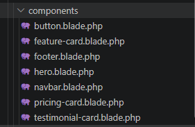

## 6. User Interface Design

- **Color palette:** Amber and stone tones to match a coffee shop feel. Amber for buttons and highlights, stone for text and backgrounds. Dark text on light backgrounds keeps good contrast.
- **Typography:** Tailwind's default sans-serif font. Large bold headings, smaller regular body text, and a clear size hierarchy.
- **Iconography:** Simple outline SVG icons inside soft amber squares for the feature cards.
- **Button styles:** Three variants (primary, secondary, light) with rounded corners, shadow, and hover color change.
- **Card design:** White cards with a light border, rounded corners, soft shadow, and a lift effect on hover.
- **Layout consistency:** Every section uses the same container width (`max-w-7xl`), padding, and vertical spacing.

These choices make the page look organized, help visitors find information quickly, and keep the brand feel consistent from top to bottom.

## 7. Folder Structure

```
week05-product-landing-page/
├── app/
├── resources/
│   └── views/
│       ├── layouts/        app.blade.php
│       ├── components/     reusable Blade components
│       └── pages/          home.blade.php
├── public/
├── screenshots/
├── documentation/
└── README.md
```

| Folder | Purpose |
|---|---|
| `resources/views/layouts` | Main layout that every page extends |
| `resources/views/components` | Reusable UI components |
| `resources/views/pages` | Full pages that use the layout and components |
| `public` | Public assets such as images and compiled files |
| `screenshots` | Screenshots of the project for documentation |
| `documentation` | Before-and-after comparison images |

## 8. Screenshots

**Desktop View**
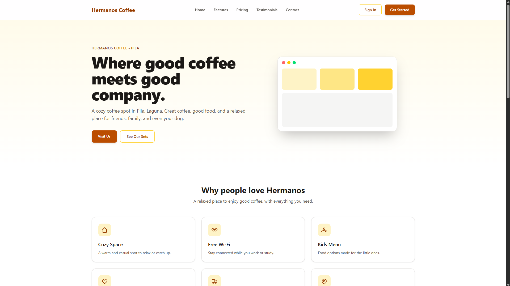

**Tablet View**
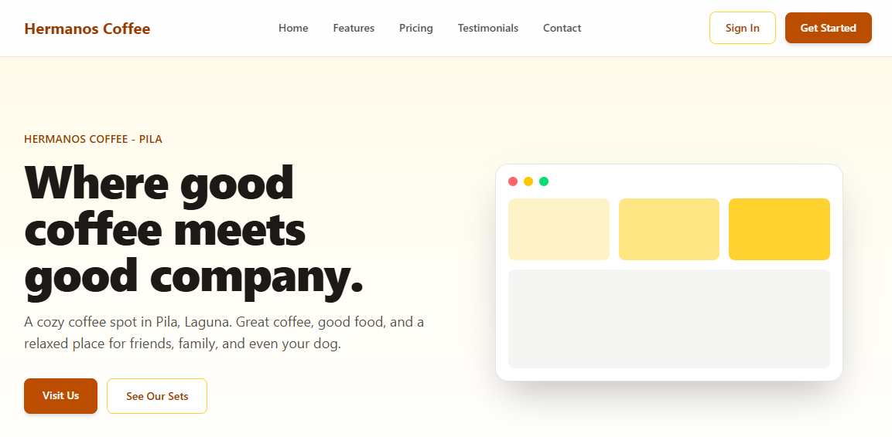

**Mobile View**
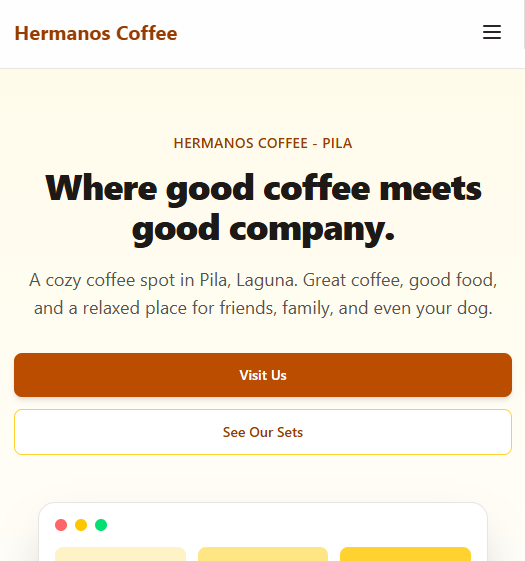

**Navigation Bar**
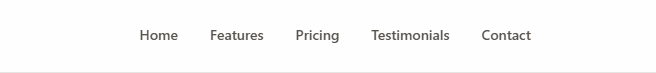

**Hero Section**
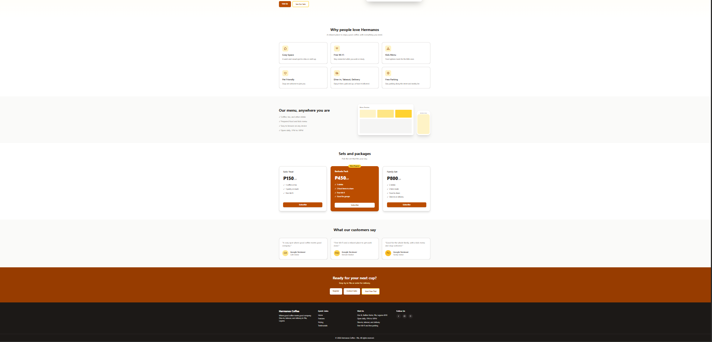

**Features Section**
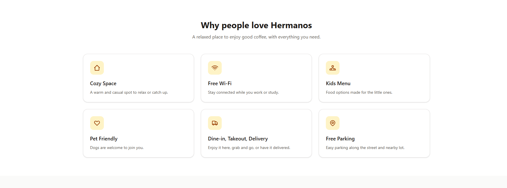

**Pricing Section**
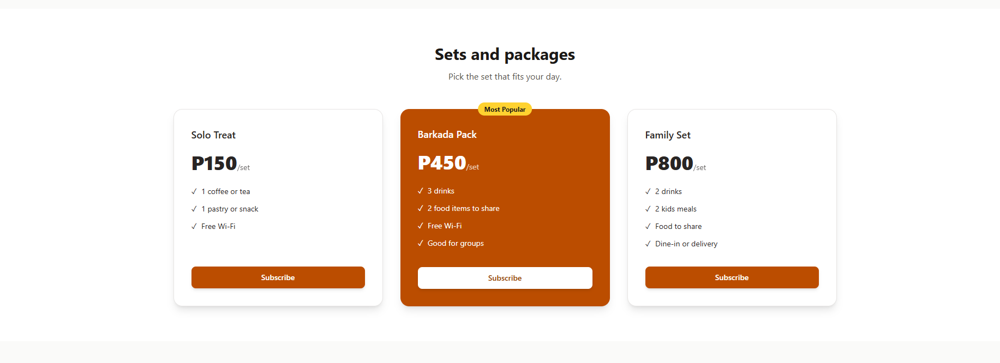

**Testimonials**
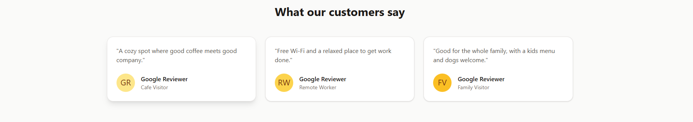

**Footer**
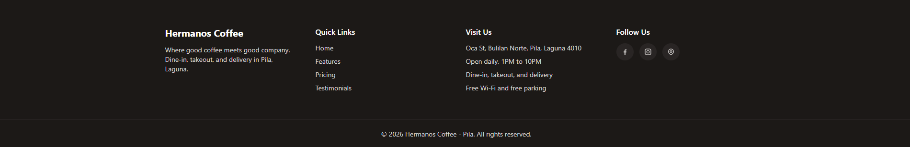

**VS Code Project Structure**
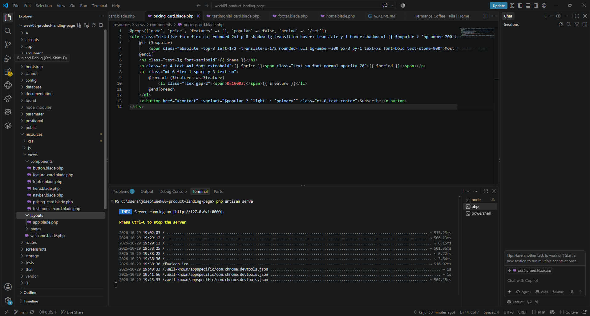

**Blade Components Folder**


**GitHub Repository**
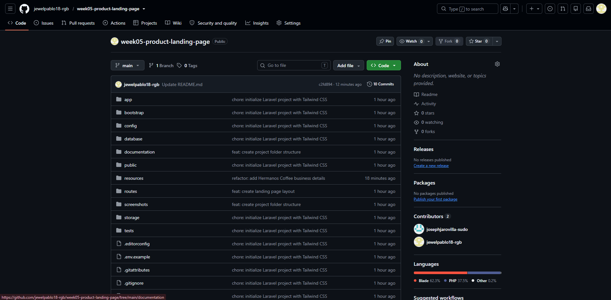

## 9. Before and After

**Before:** early wireframe with basic layout and no styling.
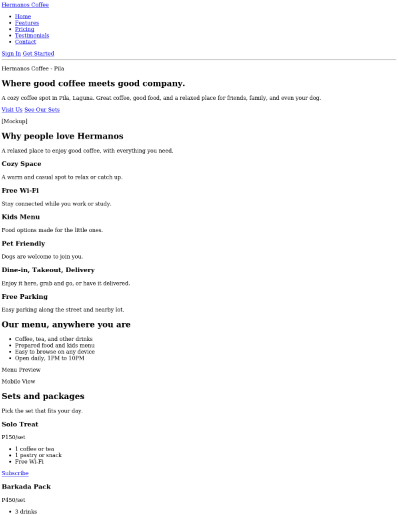

**After:** final responsive interface with improved visual hierarchy, consistent colors, and better usability.
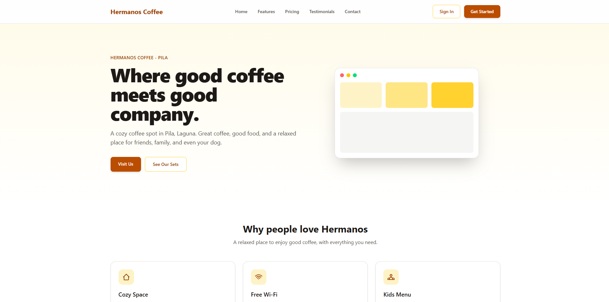

**Improvements made**
- Added a consistent color palette and spacing
- Turned repeated sections into reusable components
- Added responsive grids and a mobile menu
- Added hover effects, shadows, and rounded corners

## 10. Problems and Solutions

| Problem | Solution |
|---|---|
| `Vite manifest not found` error when opening the page | Ran `npm run dev` (or `npm run build`) before `php artisan serve` |
| `mkdir -p` failed in PowerShell and created wrong folders | Used PowerShell syntax and removed the wrong folders and file |
| Different button styles repeated in many places | Created one `button` component with variants |
| Layout looked broken on small screens | Used mobile-first classes and breakpoint prefixes, tested with browser dev tools |
| Content needed to match a real business | Used publicly available information about Hermanos Coffee (location, hours, amenities, services) |

## 11. Reflection

(Isulat mo ito sa sarili mong salita. 3 to 5 sentences. Halimbawa: ano ang pinakamahirap, ano ang natutunan mo sa Blade Components at Tailwind, at paano mo magagamit ito sa susunod na project.)

## How to Run

```bash
composer install
npm install
cp .env.example .env
php artisan key:generate
npm run dev
```

In a second terminal:

```bash
php artisan serve
```

Open http://127.0.0.1:8000

## Notes

The business details (name, address, hours, and amenities) come from public information about Hermanos Coffee - Pila. The set packages, prices, and testimonials on the page are sample content for this academic project.

## Author

Joseph - BSIT Student
ITST 302 - Client-Server Technologies
